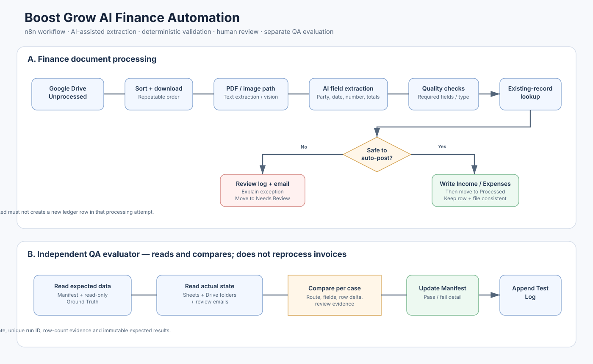

# AI Finance Document Automation (n8n)

An n8n-based prototype that extracts structured fields from invoice documents, applies deterministic validation and duplicate/conflict checks, routes uncertain cases for human review, and supports finance reporting.

> **Current evidence:** The latest saved strict QA baseline contains 25 cases: **19 PASS, 6 FAIL (76% pass rate), 0 incomplete**. Three cases (18–20) are grouped as higher-priority duplicate/ledger-state issues because historical finance rows overlap later review logs. Three further mismatches (06, 08, 25) involve routing or extraction. This grouping is for triage only; it does not change the measured result. The 100-document matrix is a **plan, not a completed test**. This project is a prototype and is not presented as production-ready bookkeeping software.

## Business problem

Small agencies receive income invoices, supplier invoices, receipts and other financial documents in mixed formats. Manually reviewing each document and entering its key values creates repetitive work and risks inconsistent records. Fully automatic posting is also unsafe when key fields are missing or a document resembles an existing invoice.

## What the prototype does

- Intake of PDF and image-based finance documents from a Drive queue.
- PDF text extraction and AI-assisted structured field extraction.
- Classification and routing into income or expenses.
- Required-field and transaction-direction checks.
- Existing-record lookup to flag likely duplicates or invoice-number conflicts.
- Human-review routing for missing, ambiguous or unsupported files.
- Google Drive and Google Sheets output, plus a separate QA evaluator.
- Manifest-based tests comparing observed state against expected outcomes.

## Architecture



**Finance path:** Drive intake → sort/download → text or image extraction → structured fields → deterministic checks → existing-record lookup → ledger write or human review → final file move/logging.

**QA path:** load manifest and read-only ground truth → inspect finance sheets, Drive destinations and review evidence → compare actual state → record per-case result and batch summary.

See [technical overview](docs/technical-overview.md) and [QA results](docs/qa-results.md).

## Latest recorded QA baseline

| Metric | Result |
|---|---:|
| Test cases | 25 |
| Strict PASS | 19 |
| Strict FAIL | 6 |
| Incomplete | 0 |
| Strict pass rate | 76% |

### Issue triage

- **Higher priority — cases 18–20:** duplicate/conflict and ledger-state cases need a clean state-controlled retest because older finance rows overlap newer review-log entries.
- **Other open mismatches — cases 06, 08, 25:** one conservative route to review, one vendor-name normalization difference and one expense-category mismatch.

See [case-level findings](docs/qa-results.md). Do not interpret the severity grouping as reducing the six strict failures.

## 100-document validation: planned, not run

A 100-case regression/load-test matrix is included with every row marked `PLANNED_NOT_GENERATED` for fixtures and `NOT_RUN` for execution. It is a plan for a future test, not evidence that 100 invoices were processed successfully.

A separate time model estimates about **8h 35m saved per 100 documents** under assumptions of 6.5 minutes manual work/document, 1 minute human follow-up/document and a linearly extrapolated automation runtime. These are estimates, not measured savings. See [time-saving model](docs/time-savings.md) and [100-document test plan](docs/100-document-test-plan.md).

## Repository structure

```text
.
├── README.md
├── GITHUB_UPLOAD_CHECKLIST.md
├── docs/
│   ├── architecture.svg
│   ├── technical-overview.md
│   ├── qa-results.md
│   ├── 100-document-test-plan.md
│   ├── time-savings.md
│   ├── limitations-and-roadmap.md
│   ├── demo-recording-script.md
│   ├── screenshot-guide.md
│   ├── security-and-publishing.md
│   └── assets/README.md
├── evidence/
│   ├── qa-summary.csv
│   ├── 100-document-test-matrix.csv
│   └── screenshots/README.md
├── workflows/README.md
├── samples/README.md
└── .gitignore
```

## Demo assets

Authentic screenshots and the screen recording have **not yet been added**. Follow [screenshot guide](docs/screenshot-guide.md) and [demo script](docs/demo-recording-script.md) to capture evidence from the real n8n account. Never replace real product screenshots with generated mock screenshots.

## Known limitations

- Six discrepancies remain in the latest strict QA baseline.
- Duplicate/conflict behavior requires a controlled clean-state retest.
- Vendor normalization and one category mapping need a policy/code review.
- Actual manual and post-automation human handling times have not been measured.
- A clean 100-document regression/load test has not been run.
- Any supplied finance-month figures should be labeled synthetic demo data unless independently verified as real.
- The current workflow has not been validated as a production accounting system.

## Security and responsible publishing

This repository intentionally excludes raw workflow exports and account-specific configuration until they can be sanitized. Before adding n8n JSON, remove credential references, private URLs/IDs, personal emails, execution payloads and business data. Use synthetic test fixtures only. See [security and publishing guide](docs/security-and-publishing.md).

## Technology

n8n, Google Drive, Google Sheets, Gmail, OpenAI/Gemini model nodes, PDF/image extraction, data-table-based test manifests and CSV/JSON evidence.
